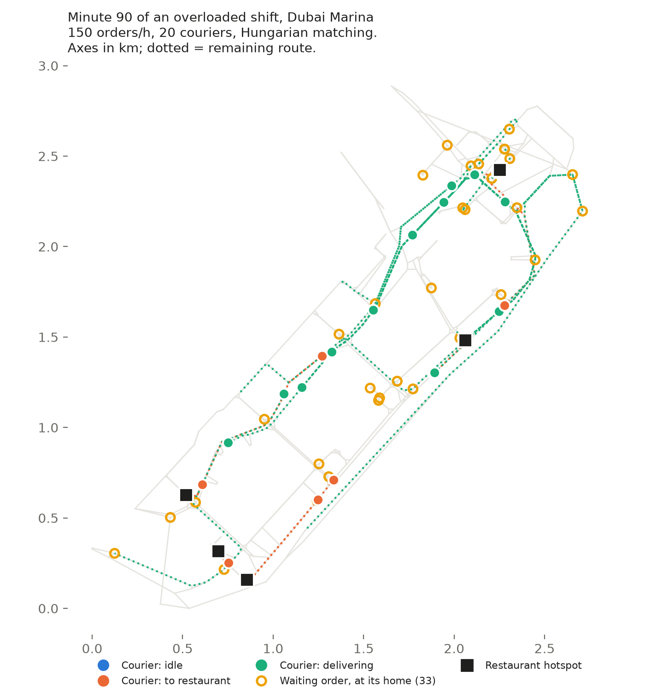
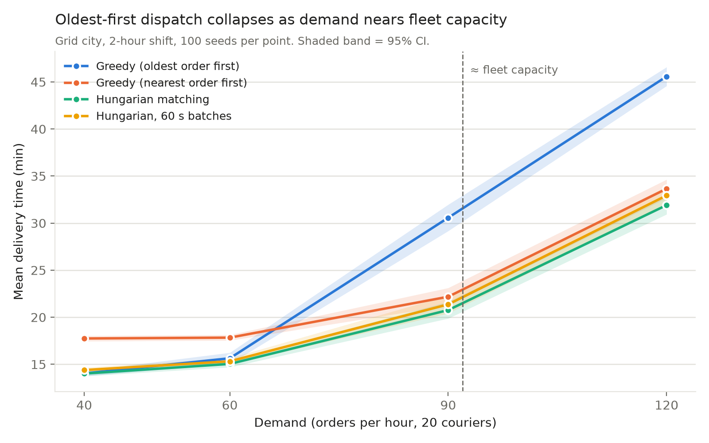

# Courier Dispatch Simulator

When food and grocery orders arrive faster than a platform can think, *which courier gets which order* decides how long customers wait. This project simulates a city of orders and couriers, on a grid and on real Dubai Marina streets, and compares dispatch strategies on delivery time, courier idle time and fairness.

## Strategies

| Strategy | Rule |
|---|---|
| `greedy` | Oldest waiting order first; each goes to the nearest free courier |
| `greedy_nearest` | Each free courier (by id) takes its nearest waiting order. A **control**, added to explain why Hungarian wins |
| `hungarian` | Optimal one-round matching: minimise total courier-to-restaurant time (`scipy.optimize.linear_sum_assignment`) |
| `batch_30s / 60s / 120s` | Hold orders, then run Hungarian every N seconds |

## Setup

20 couriers, 2-hour shift, 5 restaurant hotspots, Poisson order arrivals, 5 m/s (18 km/h) scooters, 10 s time step, plus a 1-hour drain so late orders still count. **100 seeds per scenario**, and within a seed every strategy faces identical orders and courier starts (a paired design). Real streets come from OpenStreetMap via `osmnx` and keep one-way roads.

## Results: Dubai Marina, mean over 100 seeds

| demand | strategy | mean delivery (min) | p90 (min) | max (min) | backlog at shift end |
|---|---|---|---|---|---|
| normal (60/h) | greedy | 12.4 | 19.4 | 31.0 | 0.3 |
| | greedy_nearest | 14.6 | 22.8 | 34.6 | 0.2 |
| | **hungarian** | **12.2** | **19.3** | **30.5** | 0.1 |
| | batch_60s | 12.5 | 19.7 | 30.5 | 0.1 |
| busy (90/h) | greedy | 19.0 | 29.6 | **43.5** | 15.1 |
| | greedy_nearest | 16.4 | 27.5 | 46.1 | 6.8 |
| | **hungarian** | **15.3** | **26.3** | 44.1 | **6.3** |
| | batch_60s | 15.6 | 27.1 | 45.2 | 6.9 |
| peak (150/h) | greedy | 45.6 | 75.7 | **88.7** | 123.3 |
| | greedy_nearest | 32.0 | 72.6 | 113.9 | 82.5 |
| | **hungarian** | **31.0** | **71.0** | 112.6 | **80.3** |
| | batch_60s | 32.4 | 73.9 | 116.9 | 86.1 |

Full tables with standard deviations: [`results/summary_dubai_marina.md`](results/summary_dubai_marina.md) (real city) and [`results/summary.md`](results/summary.md) (grid). Paired comparisons with 95% confidence intervals: [`results/paired_mean_delivery.txt`](results/paired_mean_delivery.txt), [`results/paired_max_delivery.txt`](results/paired_max_delivery.txt).

## Findings

1. **Below capacity, strategy barely matters**, with one exception: `greedy_nearest` is 2–3 min worse, because the lowest-id courier takes the only waiting order wherever that courier is.
2. **Near and above capacity, oldest-first collapses.** At peak, Hungarian saves 14.6 min per order over `greedy`. **About 13.6 min of that (≈93%) comes simply from serving the nearest order**, as the `greedy_nearest` control shows. Optimal joint matching adds about 1 min on top. Small, but real: on the grid it beat `greedy_nearest` by 1.4 min at busy demand (95% CI [1.2, 1.6], 93/100 seeds) and 1.7 min at rush (95% CI [1.5, 2.0], 97/100 seeds).
3. **Batching never paid off.** Its cost matches theory: average wait-to-assign grows by half the batch interval (0.08 → 0.25 → 0.50 → 1.01 min at quiet demand), and better matches never won that time back.
4. **Nearest-first strategies sacrifice the unluckiest customer.** On the grid at rush hour, `greedy` gave a lower worst-case delivery time than `hungarian` by 5.4 min (paired, 100 seeds, 95% CI [1.6, 9.2]), but `greedy` won on only 55/100 shifts. The starvation is rare but large. On real streets the gap grows to **about 24 min at peak** (88.7 vs 112.6), because detours and one-way roads create far-away pockets that nearest-first keeps skipping.

## What surprised me

- The headline "Hungarian is ~30% faster at rush hour" was **mostly not about Hungarian**. Adding a one-line control strategy showed that most of the gain comes from a simple rule change.
- The starvation question changed answer as evidence grew: suspected at 1 seed, inconclusive at 20 (CI crossed zero), confirmed at 100. Seed count matters most for tail metrics like the maximum.
- **The toy grid understated the problems.** Real streets made the worst-case gap about 5× bigger and made nearest-first's courier workload the least fair of any result (Gini 0.42 vs 0.30).

## Limitations

Food is ready the instant it is ordered (this is why batching cannot win). Constant speed, no traffic. One order per courier at a time. Couriers jump between junctions on schedule rather than moving continuously. Restaurant hotspots are placed at random, not from real restaurant data.

## What I'd test next

- **Restaurant prep times**, then re-test batching. Waiting is free while food cooks, which is why real platforms batch.
- **Age-aware matching cost**, e.g. `travel_time − α·time_waited`, to keep Hungarian's mean without its worst-case starvation.
- **Rebalancing** idle couriers toward predicted demand, and **stacked orders** (two orders per trip).
- **Learning-based dispatch** evaluated against these baselines.
- More cities: `python -m experiments.run_real istanbul_kadikoy`.

## How to run

    python3 -m venv .venv && source .venv/bin/activate
    pip install -r requirements.txt
    pytest                                           # 21 tests
    python -m experiments.run_all                    # grid: 2,400 simulations, seconds
    python -m experiments.run_real dubai_marina      # downloads + caches the map the first time
    python -m experiments.summarise dubai_marina     # results table
    python -m experiments.paired max_delivery_min    # paired comparison with 95% CIs
    python -m experiments.plot_results               # demand chart
    python -m experiments.plot_snapshot dubai_marina # map frame

## Structure

    sim/          city model, orders/couriers, demand, simulation loop, metrics, real-city loader
    strategies/   greedy, greedy_nearest, hungarian, batching (shared Strategy interface)
    experiments/  experiment runners, summaries, paired statistics, charts
    tests/        distances, assignment validity, repeatability, optimality, real-city checks
    results/      CSVs, summary tables, charts, maps
